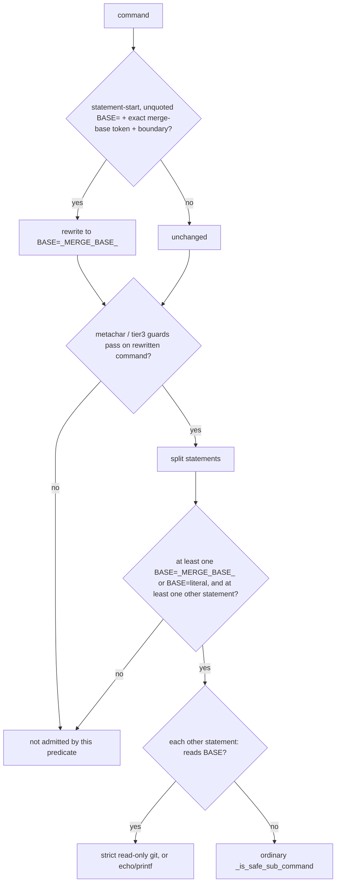

# Admit the ce-code-review scope probe's BASE assignment - Plan

**Target repo:** claude-pilot. Origin dossier: senara-solutions/mika#1686 (dormant, wake condition met 2026-10-12).

## Goal Capsule

- **Objective:** a pilot running the `/mika` pipeline's ce-code-review step gets its scope probe (`BASE=$(git merge-base …) … git diff --name-only $BASE …`) executed instead of refused, so the review step stops burning a turn and a rewrite on every run.
- **Means:** one whole-command tier1 predicate that admits the probe shape and nothing that could use `BASE` to steer a write (KTD1, KTD3, KTD4).
- **Authority:** R-IDs win on behavior; KTDs win on mechanism. Every existing refusal outside the F1 shape must stay byte-identical (R4).
- **Stop conditions:** stop and report if the corpus replay (R4) shows any admission change outside the F1 shape, or if a negative in R3 turns admitted.
- **Execution profile:** local commits only, on `fix/1686/ce-review-scope-base-assignment`. No push, no PR, no GitHub write. The PR body is written to a file. Merge requires Vincent's ratification (classifier gate).

---

## Product Contract

### Summary

Teach tier1 to accept a command that assigns the shell variable `BASE` from an already-allowlisted `git merge-base` substitution or from a literal ref, provided every later use of `$BASE` is a read-only git command or an `echo`/`printf`. A probe whose only refused segment is the `BASE=` assignment becomes admissible; probes that carry another refused segment stay refused (R2).

### Problem Frame

Replay of the 271 Bash refusals logged by 67 pilots between 2026-09-28 and 2026-10-02, against the deployed module (`main` 1581d74, bundled policy, `MIKA_PILOT_CONTAINED=1`), shows the ce-code-review scope probe refused in 7 distinct pilots (2bd6fca0, 39ae2723, 819e8f6b, 946d2786, 9c880b93, b8f2b4b6, c37a432e). This is form F1 of the replay: `BASE=$(git merge-base HEAD <main|origin/main> [2>/dev/null]) [|| BASE=<ref>]`, followed by `echo "BASE:$BASE"`, `git diff --name-only $BASE` and `git ls-files --others --exclude-standard`. It meets mika#1686's wake condition: the same legitimate shape, refused at admission, in at least 3 pilots within 7 days, established by verbatim replay.

Probing the segments in isolation shows that only the assignment blocks. The merge-base tokens are already on the closed `_SUBSTITUTION_ALLOWLIST` (cpp#95, cpp#98), but that redaction runs only on the policy chain-safe path, and no policy rule allows a command that starts with `BASE=`.

Admitting the assignment is not inert by itself. Tier1 already passes `git push origin $BASE`, `git checkout $BASE`, `git branch $BASE`, `git tag $BASE` and `git worktree add $BASE` (measured on 1581d74), because their literal guards (`git push … main`, `_MAIN_MASTER_RE`) cannot see through a variable. Today no pilot can set the variable. A bare `BASE=main` admission would turn `BASE=main; git push origin $BASE` into a push to main.

### Requirements

**Admission**

- R1. A command is tier1-safe when it contains at least one statement `BASE=<v>` (where `<v>` is one of the 8 allowlisted merge-base substitutions or a literal ref: alphanumeric first char, then `[A-Za-z0-9._/-]`, optionally double-quoted) plus at least one other statement, and every other statement is otherwise tier1-safe.
- R2. Every F1 verbatim whose only refused segment is the `BASE=` assignment is admitted by the real permission handler. Verbatims that also carry another refused segment stay refused and are named in the verification record.

**Containment**

- R3. Every statement that reads `BASE` (`$BASE`, `${BASE…}`) must be a read-only git command or an `echo`/`printf`. These stay refused: `BASE=main; git push origin $BASE`, `BASE=master && git push origin $BASE`, `BASE=main; git checkout $BASE`, `BASE=main; git branch $BASE`, `BASE=main; cat $BASE`, `PATH=$(pwd); git status`, `BASE=$(id -u); echo $BASE`, `BASE=$(git merge-base HEAD main || echo main); echo $BASE`, `BASE=$X; echo $BASE`, `BASE=main; rm -rf x`, `BASE=main git log`, `export BASE=main; echo $BASE`, `XBASE=$(git merge-base HEAD main); echo $XBASE`, `BASE=$(git merge-base HEAD main)x; echo $BASE`, `BASE='a b'; echo $BASE`, `BASE=-x; echo $BASE`, `BASE=..; echo $BASE`, `echo "x; BASE=$(git merge-base HEAD main)"`, the bare segment `BASE=main` alone, and `git status; BASE=$(pwd)` through the handler.
- R4. Admission is byte-identical to `main` on the real corpus outside the F1 shape. The corpus is the 271 replayed refusals plus every Bash command in recent `~/.mika/data/pilot-transcripts/`.

### Scope Boundaries

- Other awakened forms from the same replay are out of scope for this change: the ce-review scratch preamble (F2), groom `P=<plan path>` probes (F3), `sed -n "$(grep -n …|cut …),+Np"` (F4), and sed programs with a quoted `|`/`;` (F5).
- Non-goal, considered and not built: a general "inert variable assignment" rule. It needs a variable-name policy and a reader policy per name, a design ruling for the classifier gate. Evidence that would change the call: F3 ratified with such a policy.
- Non-goal, considered and not built: fixing the pre-existing tier1 admission of `git push origin $VAR` for an unset or environment variable. It predates this change and is reachable today only through variables the pilot cannot set. This plan only guarantees that `BASE` cannot become such a variable. Evidence that would change the call: any admitted assignment form beyond F1.
- Non-goal: a containment gate on the predicate. The reader restriction (KTD4) is what bounds the effect, with or without bwrap.

### Deferred to Follow-Up Work

- F2, F3, F4, F5 tickets: drafted in files alongside this work and opened by MPC after ratification.

---

## Planning Contract

### Key Technical Decisions

- KTD1. **Quote-aware redaction to a dedicated placeholder.** A pre-pass rewrites `BASE=<exact merge-base token>` into `BASE=_MERGE_BASE_` only when the occurrence starts a statement (string start, or after `;`, `&`, `|`, `\n`, `\r`, then optional blanks), is followed by a boundary (whitespace including `\n`/`\r`, end, `;`, `&`, `|`), and does not start inside a quoted span (tier1's shared quote scanner). `_MERGE_BASE_` is never produced by `permissions._redact_allowlisted_substitutions`, so the policy path's `_SUB_` can never satisfy this predicate.
- KTD2. **One source for the merge-base tokens.** Hoist the 8 merge-base strings from `permissions._SUBSTITUTION_ALLOWLIST` into a tier1 tuple and splice it back in the same position. Content and order stay identical.
- KTD3. **A whole-command predicate, never a per-segment one.** The policy chain-safe path checks segments one by one through `is_safe_bash_command(seg)`, so a per-segment `BASE=` predicate would let `git status; BASE=main; git push origin $BASE` through: each segment passes alone. The predicate therefore requires the assignment and at least one other statement in the same call, and does not touch `_is_safe_sub_command`. A segment that is only `BASE=…` stays refused wherever it is checked alone.
- KTD4. **Readers of BASE are restricted.** Any statement that references `BASE` must pass the existing strict read-only git predicate (`_is_safe_git_readonly_sub`, after the usual `N>/dev/null` strip) or be an `echo`/`printf` that is otherwise tier1-safe. Statements that do not reference `BASE` go through the ordinary `_is_safe_sub_command`. The exact name `BASE` keeps `PATH=`, `IFS=` and every other name out of reach.

### High-Level Technical Design

The predicate is tried after the two existing containment-gated whole-command predicates and before the generic path. When it does not match, the generic path runs unchanged.

---

## Implementation Units

### U1. Hoist the merge-base tokens into tier1

- **Goal:** one definition of the merge-base substitution tokens, shared by tier1 and permissions.
- **Requirements:** R4 (KTD2).
- **Dependencies:** none.
- **Files:** `src/claude_pilot/tier1.py`, `src/claude_pilot/permissions.py`.
- **Approach:** define the tuple in tier1. Replace the 8 literal entries in `_SUBSTITUTION_ALLOWLIST` with the splice, keeping order.
- **Test expectation:** none new. The existing allowlist membership tests in `tests/test_policy_devpilot.py` must pass unchanged.
- **Verification:** `_SUBSTITUTION_ALLOWLIST` is unchanged in content and order (checked once in the session, not as a fixture).

### U2. Whole-command BASE scope-probe predicate

- **Goal:** admit the F1 shape at tier1 (R1, R2) without admitting anything in R3.
- **Requirements:** R1, R2, R3 (KTD1, KTD3, KTD4).
- **Dependencies:** U1.
- **Files:** `src/claude_pilot/tier1.py`, `tests/test_tier1.py`.
- **Approach:**
  1. Add the quote-aware redaction helper (KTD1).
  2. Add the whole-command predicate (KTD3, KTD4) and call it from `is_safe_bash_command` after the two containment-gated predicates, passing `cwd`.
- **Patterns to follow:** `permissions._redact_allowlisted_substitutions` (exact-token closed world), `is_git_readonly_compound_when_contained` (whole-command predicate that re-runs the metachar and tier3 guards itself).
- **Test scenarios:**
  - Each of the 8 merge-base tokens as `BASE=<token>; git diff --name-only $BASE` is tier1-safe.
  - `BASE=main; git log $BASE`, `BASE="origin/main"; echo "BASE:$BASE"`, `BASE=6d835590; git diff $BASE` are tier1-safe.
  - The 9c880b93 and 2bd6fca0 verbatims are tier1-safe, and so is a multi-line version with newline separators.
  - Every R3 negative is not tier1-safe.
  - The redaction helper returns a command without `BASE=` unchanged, and leaves a quoted occurrence untouched.
- **Verification:** new tests green.

### U3. Term-by-term mutation proof

- **Goal:** prove each condition of KTD1, KTD3 and KTD4 is load-bearing.
- **Requirements:** R3.
- **Dependencies:** U2 committed.
- **Files:** none beyond U2's tests, unless a mutation survives (then add the missing test to `tests/test_tier1.py`).
- **Approach:** mutate one term at a time on the committed tree and run the U2 tests. Restore with git after each. The mutations are:
  1. Drop the statement-start anchor.
  2. Drop the trailing boundary.
  3. Drop the quote check.
  4. Widen the exact token match to any `$(…)`.
  5. Accept `_SUB_` as well as `_MERGE_BASE_`.
  6. Widen the name to `\w+`.
  7. Widen the literal charset to accept `$`.
  8. Drop the first-char restriction.
  9. Drop the at-least-one-other-statement requirement.
  10. Drop the reader restriction.
  11. Drop the metachar or tier3 re-check.
- **Test expectation:** none beyond U2. This unit exercises U2's tests.
- **Verification:** a recorded table of each mutation and the red test it produced.

### U4. Real-handler verbatim replay and corpus parity

- **Goal:** show R2 on the real permission handler and R4 on the real corpus.
- **Requirements:** R2, R3, R4.
- **Dependencies:** U2.
- **Files:** `tests/test_permissions.py`.
- **Approach:** add handler-level tests through `create_permission_handler`. Outside the repo, replay the 271 refusals and the transcript corpus through old (`main`, via `PYTHONPATH`) and new code, and diff the tier1, policy and chain-safe outcomes.
- **Test scenarios:**
  - The handler allows the 9c880b93 verbatim with `MIKA_PILOT_CONTAINED=1`.
  - The handler refuses `git status; BASE=main; git push origin $BASE` and `git status; BASE=$(pwd)`.
- **Verification:** the corpus diff contains only F1 verbatims. The F1 verbatims that stay refused are listed with their other refused segment.

---

## Verification Contract

| Gate | Command | Applies to |
|---|---|---|
| Lint | `uv run ruff check` | all units |
| Types | `uv run mypy src` | all units |
| Tests | `uv run pytest` | all units |
| Mutations | each U3 mutation turns a U2 or U4 test red | U3 |
| Corpus parity | old vs new replay, only F1 differs | U4 |

## Definition of Done

- R1 to R4 hold, with test or replay evidence for each.
- Every U3 mutation was seen red.
- ruff, mypy and pytest are green.
- Work committed locally on the branch, nothing pushed, and no abandoned-attempt code left in the diff.
- PR body and cpp ticket drafted in files, stating that Vincent's ratification is required.
